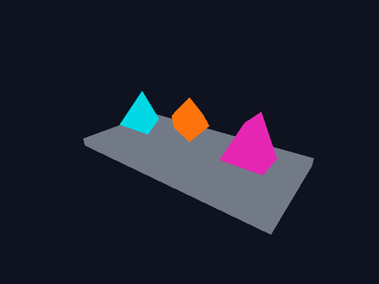

# Entangle



A verification-driven 3D engine for interactive worlds and simulations, built in Bend.

Entangle is an experimental game and simulation engine exploring what a Bend-first
architecture can look like. It uses Bendvy to manage objects and their behavior
through an entity-component system (ECS), and bend-vulkan to render them.

The goal is to build interactive worlds whose behavior can be inspected,
reproduced, checked, and, where possible, formally verified. Longer-term
directions include parallel simulation and AI-assisted development with
machine-checkable results.

**Status: Early experimental project.** ECS-driven rendering works, but Entangle
is not yet a general-purpose game engine.

## What works today

- Define 3D scenes in Bend with meshes, basic color materials, instances, and cameras.
- Run scheduled systems with Bendvy while keeping world state separate from rendering data.
- Render scenes in an interactive X11 or XWayland window, or to an image without a window.
- Advance simulations without a window, Vulkan, or a GPU.
- Check behavior with Bend laws and proofs, native execution, rendering checks, and resource cleanup checks.
- Record CPU and GPU timings using documented workloads and measurement boundaries.

## Try the interactive demo

The current native build requires:

- Linux x86-64, Bend 2.0.39, and Clang 23.1.4, with the tools on `PATH`.
- Node.js or Bun for Bend's default runner.
- Vulkan development headers, `libvulkan.so.1`, and a Vulkan driver with a graphics queue.
- X11 development headers and an X11 or XWayland display with Vulkan presentation support.
- Entire Git transport and access to the bend-vulkan repository.

The exact toolchain and dependency versions are recorded in
[toolchain.bend](toolchain.bend). After cloning, run from the repository root:

```sh
git -c protocol.entire.allow=always submodule update --init deps/bendvy deps/bend-vulkan
git -C deps/bend-vulkan submodule update --init deps/bend-collections
mkdir -p build
bend examples/scene-window.bend -o build/indexed-window
./build/indexed-window
```

The demo renders 100 ECS-controlled cubes with a movable camera. The cubes
overlap into a dense line and move over time, eventually leaving the view.
Use A/D to orbit, W/S to change elevation, Q/E to zoom, R to reset the camera,
and Esc to exit. Resetting the camera does not reset the simulation.

### Try the mesh playground

For a scene with an object you can move yourself, run:

```sh
bend examples/mesh-playground.bend -o build/mesh-playground
./build/mesh-playground
```

Hold I/K and J/L to move the orange octahedron across the platform, and U/O to
move it vertically. Space resets the object. The other shapes stay fixed.
Camera controls are the same as in the cube demo.

## Create a scene

Describe your scene with `Vertex`, `Mesh`, `Basic`, and `Instance` values, and
configure its view with a `Camera`. `Create.compile` prepares initial entities
and geometry without requiring your scene code to manage Vulkan handles.

Try the [public creation example](examples/public-creation.bend):

```sh
mkdir -p build
bend examples/public-creation.bend -o build/public-creation
./build/public-creation +RTS --threads 1 --gpu off
```

This example creates three instances and advances them through two simulation
ticks without opening a window. On success, it prints
`Public instances completed two production ECS ticks.` See the
[scene creation reference](docs/public-creation.md) for the API and its current limits.

Both production renderers support [whole-mesh replacement](docs/mesh-replacement.md).
Replacement returns the owner on rejection and defers old buffer destruction until native command references are released.

## Simulate without rendering

Entangle can advance the same ECS world without a graphics stack. This lets you
check simulation behavior without opening a window or using a GPU.

Run the headless verification:

```sh
bend tools/verify-headless.bend
```

This command builds and runs real ECS workloads using the pinned Bend and Clang
versions. It requires no Vulkan checkout, headers, loader, display, or GPU.
See the [headless reference](docs/headless-reference.md) for details.

## How it fits together

Your Bend application defines the scene. Bendvy manages its objects and runs
systems that update them. Entangle extracts drawing data into a `DrawList`,
which bend-vulkan renders on the GPU.

The renderer receives drawing data without owning the ECS world. The world can
continue to run or be inspected independently of rendering.

## Verification and evidence

Verification is part of development. The checks cover specific properties;
the entire engine is not mathematically proved.

```sh
bend PROOF.bend
bend tools/verify.bend
```

These commands check component and scene laws, native ECS behavior, Vulkan
output, and resource cleanup. They do not prove the Bend compiler, Vulkan
driver, or arbitrary game simulations correct. The native verifier requires
a working Vulkan device, but its rendering checks need no display.

Separate checks cover interactive windows and the mesh playground. See the
[rendering verification](docs/render-verification.md),
[window verification](docs/window-verification.md), and
[mesh playground verification](docs/verification/2026-11-03-mesh-playground/README.md)
for their scope and evidence. The [measured baseline](docs/baseline-measurements.md)
documents performance workloads, timing boundaries, and results.

## Where it's going

Entangle is being developed toward:

- A simpler public application API and reusable engine modules.
- Asset loading, scene hierarchies, and more expressive materials.
- Bend-native simulation experiments, including parallel updates and interactions between entities.
- Verifiable simulation workloads and AI-agent workflows that can build, check, and inspect worlds.

These are directions, not currently shipped features. Development proceeds
through small working examples backed by reproducible evidence.

## Explore the project

- [Public scene creation](docs/public-creation.md)
- [Application module registration](docs/modules-registration.md)
- [Headless execution](docs/headless-reference.md)
- [Rendering verification](docs/render-verification.md)
- [Window verification](docs/window-verification.md)
- [Mesh playground verification](docs/verification/2026-11-03-mesh-playground/README.md)
- [Native baseline measurements](docs/baseline-measurements.md)

Feedback and experiments around Bend, ECS, verification, rendering, and
simulation architecture are welcome.
